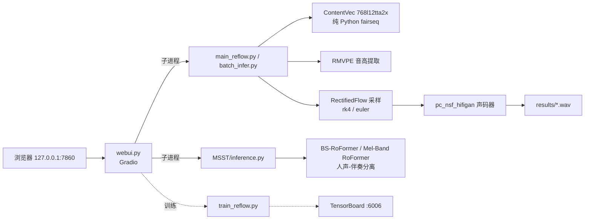

<div align="center">

# DDSP-SVC 6.2 · Windows 开箱即用部署版

**把 DDSP-SVC 6.2 + MSST 音乐分离整合 WebUI 做成"解压即用、不挑显卡、不用装 Python"的 Windows 发行版**


[快速开始](#快速开始) · [显卡适配](#显卡适配) · [端口](#两个端口) · [实测数据](#实测数据) · [常见问题](#常见问题) · [上游说明](README_upstream.md)

</div>

---

## 这是什么

上游 [DDSP-SVC 6.2](README_upstream.md) 是一个基于 DDSP + RectifiedFlow 的歌声转换（翻唱）项目，
本仓库在它 + MSST 音乐分离 WebUI 的基础上，补齐了 **Windows 上真正能一把跑起来的那一层**：

| 上游原样 | 本仓库 |
|---|---|
| 手动装 conda / 指定 4090 / 装 torch 2.4+cu124 | 双击即用；一套环境同时支持 **30/40/50 系**；无卡自动回落 CPU |
| `pip install fairseq` 在 Win + py3.10 需要 MSVC 编译，绝大多数人卡死在这一步 | fairseq 0.12.2 **纯 Python 内置**，零编译 |
| 装完还要单独配 ffmpeg、PATH、各种缓存目录 | 全部塞进 `runtime\`，`start.bat` 一次配好 |
| 权重、环境、代码混在一起，没法分发 | 代码进 git（11MB），环境与权重走 Release 附件（带 sha256 校验） |

目标只有一个：**别人拿到这个仓库，双击两次就能出第一首翻唱。**

## 特性

- **单套 CUDA 环境通吃三代卡** — `torch 2.7.1+cu128` 内含 sm_86 / sm_89 / sm_90 / sm_120 内核，
  RTX 30 系、40 系、50 系（Blackwell）用同一份环境，不用按卡挑轮子。
- **无显卡也能跑** — 同一个包在没 NVIDIA 卡的机器上自动走 CPU，功能不缺，只是慢（实测见下）。
- **纯 Python 版 fairseq** — ContentVec 编码器需要的 `load_model_ensemble_and_task` 可用，
  不依赖 MSVC / Cython 编译，这是本项目最大的一个坑，已经填平。
- **分卷发行 + 校验下载** — Release 附件按 1.9G 分卷，`tools/fetch_release.py` 自动下载、校验 sha256、合并、解压。
- **可重定位的 runtime** — `runtime\` 是便携 Python，整个目录搬到别的路径照样跑（已实测）。
- **自带自检** — `runtime\python.exe setup\verify_env.py` 一眼看出 torch/显卡/依赖/ffmpeg/权重哪个没就位。

## 两个端口

| 端口 | 服务 | 用途 |
|---|---|---|
| **7860** | WebUI 主界面 | 推理、翻唱、分离、训练 |
| **6006** | TensorBoard | 训练时看 loss 曲线、Audio 页面试听 checkpoint |

```bat
start.bat              :: 只起 WebUI   -> http://127.0.0.1:7860
start_all.bat          :: 两个一起起   -> 7860 + 6006
start_tensorboard.bat  :: 单独起 TensorBoard
```

## 快速开始

### A. 便携包（推荐，不联网、不装任何东西）

1. Releases 下载 5 个分卷：
   - `DDSP-SVC-6.2-Portable-cu128.zip.001~003` — 运行环境 + 代码，约 **4.05 G**
   - `DDSP-SVC-6.2-Weights.zip.001~002` — 模型权重，约 **3.25 G**
2. 全自动（推荐）：

   ```bat
   python tools\fetch_release.py --only all
   ```

   或手动合并后解压：

   ```bat
   copy /b DDSP-SVC-6.2-Portable-cu128.zip.001+DDSP-SVC-6.2-Portable-cu128.zip.002+DDSP-SVC-6.2-Portable-cu128.zip.003 DDSP-SVC-6.2-Portable-cu128.zip
   ```

3. 解压到**纯英文路径**（如 `D:\DDSP-SVC-6.2`），双击 `start.bat`。

### B. 仓库 + 一键装环境（需要联网）

```bat
git clone <本仓库>
cd DDSP-SVC-6.2-Win
setup\install_env.bat                    :: 自动检测显卡 -> 建 runtime\ -> 装依赖 -> 装 ffmpeg -> 自检
runtime\python.exe tools\fetch_release.py --only weights
start.bat
```

`install_env.bat` 会：检测 NVIDIA 显卡 → 装 Miniconda 到 `%LOCALAPPDATA%`（免管理员）→
`conda create -p runtime python=3.10`（走清华镜像，失败回退官方源）→ 装 torch 与全部依赖 →
装 ffmpeg → 解包内置 fairseq → 打运行时补丁 → 跑自检。

### C. 有便携包但想重建环境

删掉 `runtime\`，跑 `setup\install_env.bat`，权重目录不动。

## 显卡适配

| 显卡 | 架构 | 驱动要求 | 实际用的 torch |
|---|---|---|---|
| RTX 50 系（5090/5080/5070…） | sm_120 Blackwell | **≥ 570** | 2.7.1+cu128 |
| RTX 40 系（4090/4080/4070…） | sm_89 | ≥ 525（建议 ≥ 550） | 2.7.1+cu128 |
| RTX 30 系（3090/3080/3060…） | sm_86 | ≥ 525（建议 ≥ 550） | 2.7.1+cu128 |
| 无独显 / 驱动太旧 | — | — | 自动 CPU 回落 |

判断标准只有一个：`torch.cuda.is_available()` 为 `True` 才算真跑 GPU。
装了 cu128 但驱动过旧不会崩，只是自动用 CPU（自检会给出 warn）。

## 实测数据

在 **Windows Server 2022 / 2 核 4 线程 / 8G 内存 / 无显卡** 的机器上测得：

| 项目 | 结果 |
|---|---|
| 环境导入 | 24 个核心模块全通过 |
| fairseq ContentVec 加载 | OK（真实参与推理，非仅 import） |
| 一次推理（4~6s 音频，50 步 rk4，CPU） | **≈ 105 s**，输出 517 KB / 44.1 kHz wav |
| WebUI | `GET /` = 200（328 KB），`/config` 227 KB 正常 |
| 便携包换路径解压 | `verify_env.py` → PASS，WebUI 200，推理正常 |
| 从零跑 `install_env.bat` | PASS |

完整报告见 [docs/VALIDATION.md](docs/VALIDATION.md)。

## 架构



## 目录

```
runtime\            便携 Python 3.10 + 全部依赖 + ffmpeg（git 已忽略）
setup\              安装器 / 依赖清单 / 内置 fairseq / 自检脚本
tools\              fetch_release.py（拉附件）、make_assets.ps1（打包发版）、patch_runtime.py（运行时补丁）
pretrain\           底模：rmvpe / contentvec / nsf_hifigan            ← Release 附件
models\             用户模型（内置「薇欧拉」测试模型）                ← Release 附件
MSST\               音乐分离模块，权重在 MSST\pretrain\                ← Release 附件
exp\                训练实验目录（TensorBoard 读这里）
results\            推理输出（01_翻唱 / 02_一条龙 / 03_分离 / 04_混音）
docs\               部署、发版、实测报告、上传指引
start.bat  start_all.bat  start_tensorboard.bat  使用说明.txt
```

## 关键设计说明

**为什么 fairseq 要内置？**
`fairseq==0.12.2` 的 sdist 含 Cython 扩展，Windows + Python 3.10 上编译需要 MSVC（几个 G 的
Build Tools），绝大多数机器装不上。本仓库把它的**纯 Python 包**解到
`runtime\Lib\site-packages\fairseq`（源码包 `setup\vendor\fairseq-0.12.2.tar.gz`），
fairseq 里只有 `data_utils_fast` 是编译模块且被 `try/except` 包着，走纯 Python 回退完全够用。

**为什么权重不进 git？**
约 3.9 G（MSST 3.27 G + DDSP pretrain 0.48 G + 薇欧拉 0.28 G）。走 Release 附件 + sha256 清单，
仓库本体只有 ~11 MB，clone 秒下。

**为什么锁 fastapi/starlette？**
gradio 4.44 的 `TemplateResponse` 调用签名与新版 starlette 不兼容，会抛
`unable to ... / localhost is not accessible` 这种极具误导性的错误。锁定 `fastapi==0.115.4`、
`starlette==0.41.2` 即可；`gradio_client` 另有一个 `additionalProperties: true` 的崩溃，
由 `tools/patch_runtime.py` 幂等修复。

## 常见问题

<details>
<summary><b>启动报 <code>Cannot find empty port in range: 7860-7860</code></b></summary>

上次的进程没退干净。`taskkill /f /im python.exe` 后重新 `start.bat`。
</details>

<details>
<summary><b>报 <code>ffmpeg not found</code> / 分离失败</b></summary>

必须用 `start.bat` 启动（它把 `runtime\Library\bin` 加进 PATH）。直接跑 `python webui.py` 会没有 ffmpeg。
</details>

<details>
<summary><b>50 系显卡跑不起来 / 报 CUDA 相关错误</b></summary>

驱动版本低于 570。装新驱动，或临时用 CPU 跑（能出结果）。
</details>

<details>
<summary><b>能不能放中文路径？</b></summary>

不建议。torch 的 DLL 与便携 Python 对非 ASCII 路径偶发失败。
</details>

<details>
<summary><b>显存/内存不够怎么办</b></summary>

WebUI 里有 batch、缓存设备（cpu/cuda）、推理步数可调；步数降到 20~30 明显更快，音质略降。
</details>

## 发版（维护者）

```powershell
powershell -ExecutionPolicy Bypass -File tools\make_assets.ps1 -Repo "<owner>/<repo>" -Tag "v6.2.0"
gh release create v6.2.0 dist\*.zip.00* --title "..." --notes-file .github/release-notes\v6.2.0.md
copy /y dist\release.json tools\release.json   &&   git commit -am "chore: 指向新附件" && git push
```

细节见 [docs/UPLOAD.md](docs/UPLOAD.md)。升级策略：**代码变了只推代码**（用户 `git pull`）；
环境变了才重打 4 G 便携包；权重变了只重传 weights 分卷。

## 致谢与许可

本项目是部署封装，算法与模型来自以下上游，版权归各自作者：

- [DDSP-SVC](https://github.com/yxlllc/DDSP-SVC)（Apache-2.0）— 歌声转换主框架、RectifiedFlow、WebUI 原型
- [Music-Source-Separation-Training (MSST)](https://github.com/ZFTurbo/Music-Source-Separation-Training) — 音乐分离与模型实现
- [ContentVec](https://github.com/auspicious3000/contentvec) / HuBERT — 语义编码器
- [RMVPE](https://github.com/Dream-High/RMVPE) — 音高提取
- OpenVPI `pc_nsf_hifigan` — 声码器
- 内置测试模型「薇欧拉」由本仓库作者原创训练，仅供部署验证与试听

各权重目录内保留了上游的 `NOTICE.txt` / `STATEMENTS.txt`，请一并遵守。
本仓库自身新增的脚本与文档同样以 Apache-2.0 发布，见 [LICENSE](LICENSE)。

---

<details>
<summary><b>English</b></summary>

A Windows-ready distribution of **DDSP-SVC 6.2** with the MSST separation WebUI bundled in.

- One CUDA build (`torch 2.7.1+cu128`) covers **RTX 30/40/50 series** (sm_86/89/90/120); falls back to CPU when no GPU is present.
- `fairseq 0.12.2` is vendored as a **pure-Python package** — no MSVC toolchain required, which is the usual blocker on Windows.
- Portable, relocatable Python runtime; `start.bat` wires PATH, ffmpeg and caches.
- Weights (~3.9 GB) ship as checksum-verified, split **Release assets**; the repo itself is ~11 MB.
- Ports: **7860** WebUI, **6006** TensorBoard.

See [docs/DEPLOY_WINDOWS.md](docs/DEPLOY_WINDOWS.md) and [docs/VALIDATION.md](docs/VALIDATION.md) (Chinese).
</details>
