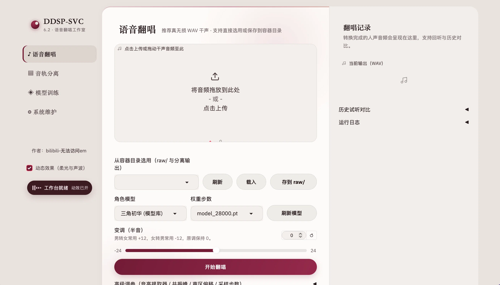
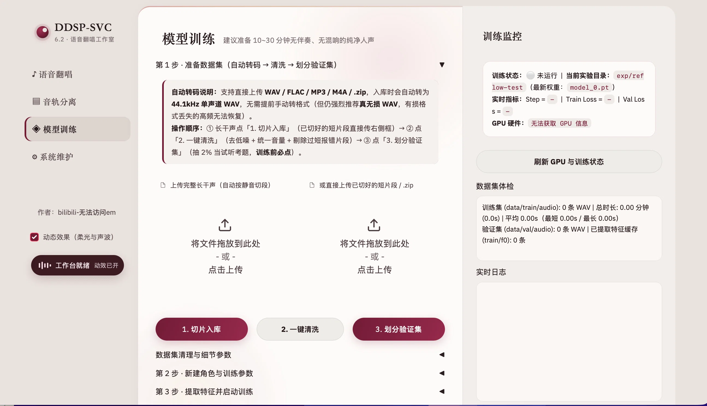

# DDSP-SVC 6.2 × MSST 语音翻唱工作室

由 **bilibili-无法访问em** 制作并整理的 Windows 一体化部署版。

本项目将 **DDSP-SVC 6.2**（歌声转换与模型训练）与 **MSST**（人声、和声、去混响三步分离）整合进同一套中文可视化工作台，无需折腾命令行，即可完成从原曲拆轨、干声翻唱、成品混音到自定义音色训练的完整流程。

> **内置测试模型说明**：`models/薇欧拉/` 为作者 **bilibili-无法访问em** 原创训练的测试音色模型，随整合包附带，仅供部署验证与翻唱试听使用。

## 界面预览

| 语音翻唱工作台 | 模型训练与实时监控 |
| :---: | :---: |
|  |  |

## 核心功能

### 1. 语音翻唱（推理与一条龙）

- **单曲精调翻唱**：支持变调（半音）、共振峰/声区偏移、音高提取器切换（推荐 `rmvpe`，抗混响与气声表现最稳）与历史试听对比。
- **二级模型选择**：按「角色模型 → 权重步数」自动归类，默认优先选中最高步数权重。
- **批量翻唱**：支持多选或从本地目录批量转换并一键打包下载。
- **一条龙翻唱（含全程追溯）**：自动串联「人声分离 → 主唱/和声分离 → 主唱去混响 → 翻唱推理 → 混音输出」，支持三种和声模式（保留原曲和声、翻唱和声、纯去和声）；每次运行都会保留 01～05 步全部中间音轨与 `run_log.txt`，可在界面内直接逐轨回听排查。

### 2. 音轨分离与混音（MSST）

- **三步主力分离模型**：内置 BS-Roformer（人声/纯伴奏）、Karaoke（主唱/原曲和声）与 Anvuew（去混响干声/混响残差）。
- **单步 / 一键三步 / 批量压缩包**：支持单模型精细分离，也支持一键三步直出纯净主唱干声，并自动将各轨重命名为易懂的中文文件名。
- **后期小工具**：内置和声与伴奏合并、音频格式清洗/降噪与人声伴奏混音（支持响度对齐与轻量混响）。

### 3. 模型训练（流水线式防呆操作）

- **第 1 步 · 数据集准备**：支持长干声自动静音切片入库，也支持直接上传已切好的短片段或 `.zip`；内置「一键清洗」与「划分验证集」。
- **第 2 步 · 角色初始化与参数**：默认推荐基于官方底模（`exp/reflow-test/model_0.pt`）微调，不建议从零训练；支持显存自动推荐参数。
- **第 3 步 · 特征提取与训练监控**：界面内一键提取特征、启停训练、查看实时 Loss 与 GPU 状态，并同步启动 `6006` 端口 TensorBoard 试听训练效果与对比检查点。

### 4. 系统维护与分类文件管理

- 所有输出结果按用途自动隔离存放，支持在「系统维护」中按分类预览、勾选打包下载或二次确认删除，也支持导入/导出模型包与一键重置环境。

## 环境要求

- **操作系统**：Windows 10 / Windows 11（64 位）
- **显卡**：NVIDIA 独立显卡（推荐 RTX 30/40 系；推理建议 8G+ 显存，训练建议 12G+ 显存）
- **驱动与基础环境**：需已安装较新版本的 NVIDIA 显卡驱动（命令行运行 `nvidia-smi` 可正常识别显卡）

整合包已内置 Python 3.10、PyTorch、FFmpeg 与全部依赖，**不需要再自己装 conda 或 ffmpeg**。
内置的 `torch 2.7.1+cu128` 一套环境同时覆盖 RTX 30/40/50 系；没有显卡的机器会自动走 CPU（能跑，只是慢）。

## 快速开始

### 方式一：使用 Windows 整合包（推荐）

1. 前往 [Releases v6.2.0](https://github.com/wufa-cat/DDSP-SVC-MSST-Studio/releases/tag/v6.2.0) 下载最新整合包：
   - `DDSP-SVC-6.2-Portable-cu128.zip.001 ~ .003` — 运行环境 + 代码
   - `DDSP-SVC-6.2-Weights.zip.001 ~ .002` — 模型权重
2. 把 5 个分卷和 release 里的 `merge_volumes.bat` 放在同一个文件夹，双击 `merge_volumes.bat` 合并出两个 zip；
   再用 7-Zip / WinRAR 解压到**不含中文和空格**的路径（例如 `C:\DDSP-SVC-6.2-Win`）。
   不想用脚本就在该文件夹的地址栏输入 `cmd`，跑这两行：

   ```bat
   copy /b DDSP-SVC-6.2-Portable-cu128.zip.001+DDSP-SVC-6.2-Portable-cu128.zip.002+DDSP-SVC-6.2-Portable-cu128.zip.003 DDSP-SVC-6.2-Portable-cu128.zip
   copy /b DDSP-SVC-6.2-Weights.zip.001+DDSP-SVC-6.2-Weights.zip.002 DDSP-SVC-6.2-Weights.zip
   ```

   已经装过 Python、或用仓库方式部署的话，也可以一条命令自动下载+校验+合并+解压：`python tools\fetch_release.py --only all`
3. 双击根目录下的 `start_windows.bat`（等同于 `start.bat`）启动服务：
   - **WebUI 主界面**：`http://127.0.0.1:7860`
   - **TensorBoard 训练监控**：`http://127.0.0.1:6006`
4. 打开浏览器进入 `7860` 端口，即可直接使用内置的「薇欧拉」模型进行测试。

### 方式二：从源码配置环境

```bat
git clone https://github.com/wufa-cat/DDSP-SVC-MSST-Studio.git
cd DDSP-SVC-MSST-Studio
setup\install_env.bat
```

`install_env.bat` 会自动检测显卡、建 `runtime\` 环境、装依赖和 ffmpeg、解包内置 fairseq 并自检，完成后同样双击 `start_windows.bat`。

需要自己接管环境时，核心是这两步（Python 3.10）：

```bat
pip install torch==2.7.1 torchvision==0.22.1 torchaudio==2.7.1 --index-url https://download.pytorch.org/whl/cu128
pip install -r setup\requirements\base.txt -i https://pypi.tuna.tsinghua.edu.cn/simple
```

`fairseq` 由仓库内置的 `setup\vendor\fairseq-0.12.2.tar.gz` 提供（纯 Python 包，不需要 MSVC 编译），
解包到 `site-packages\fairseq` 即可，不要再去 pip 装它。

## 输出目录说明

所有运行产物均统一保存在 `results/` 下，按用途分为 4 个独立目录：

```
results/
├── 01_翻唱结果/        # 单首推理（cover_歌名_模型_时间.wav）与批量推理压缩包
├── 02_一条龙翻唱/      # 每次一条龙任务的独立文件夹（01~05 全过程音轨 + run_log.txt）
├── 03_模型分离结果/    # MSST 单步、三步全分离与批量分离结果（中文轨名）
└── 04_混音与后期处理/  # 人声伴奏混音、和声合并与音频清洗输出
```

## 音频素材与使用建议

- **强烈推荐使用真无损 WAV**：虽然界面支持上传 MP3 / FLAC / M4A 等格式并会自动转为 44.1kHz WAV，但有损格式丢失的高频泛音无法通过转码恢复，会直接影响翻唱清晰度与模型训练质量。
- **训练前请务必手动把关干声**：本工具不提供「一键盲训」，建议先用「音轨分离」提取出干净、无混响、无伴奏残留的主唱干声，试听确认质量后再进入「模型训练」。
- **动效开关**：如果低配设备或远程桌面下觉得页面动画偏卡，可在左侧边栏取消勾选「动态效果（柔光与声波）」。

## 常见问题

- **启动报 `Cannot find empty port in range: 7860-7860`**：上次进程没退干净，`taskkill /f /im python.exe` 后重开。
- **报 `ffmpeg not found` 或分离失败**：没有用 `start_windows.bat` / `start.bat` 启动，PATH 里没有 ffmpeg。
- **RTX 50 系报 CUDA 错误**：驱动版本低于 570。
- **路径带中文**：不建议，torch 的 DLL 与便携 Python 对非 ASCII 路径偶发失败。
- 更细的排障与实测数据见 [`docs/VALIDATION.md`](docs/VALIDATION.md)、[`docs/DEPLOY_WINDOWS.md`](docs/DEPLOY_WINDOWS.md)。

## 致谢与声明

- 底层算法与模型架构基于开源项目 [DDSP-SVC 6.2](https://github.com/yxlllc/DDSP-SVC)（MIT, © yxlllc）与
  [Music-Source-Separation-Training (MSST)](https://github.com/ZFTurbo/Music-Source-Separation-Training)（MIT, © Roman Solovyev），
  以及 [ContentVec](https://github.com/auspicious3000/contentvec) / [RMVPE](https://github.com/Dream-High/RMVPE) / OpenVPI `pc_nsf_hifigan`。
- WebUI 界面、三步分离联动、一条龙追溯及 Windows 整合部署由 **bilibili-无法访问em** 制作维护。
- 各权重目录保留了上游的 `NOTICE.txt` / `STATEMENTS.txt`，请一并遵守；本仓库新增脚本与文档为 MIT，见 [LICENSE](LICENSE)。
- 请合理合法使用本工具与内置测试模型，严禁用于任何侵权、诈骗或违反法律法规的用途。
